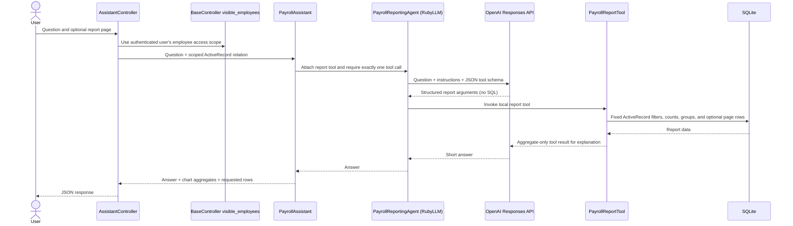
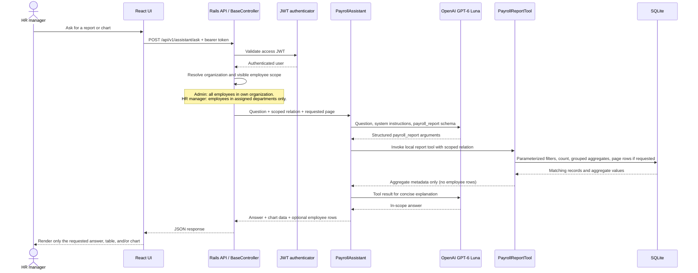
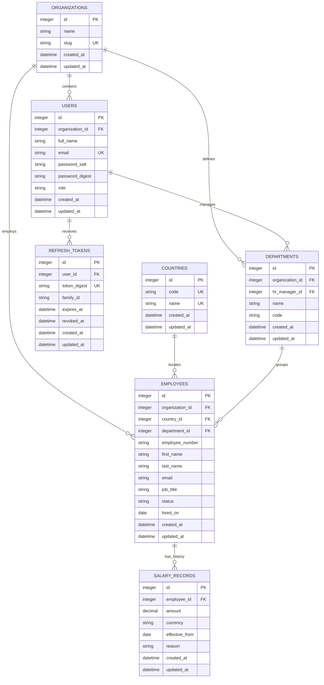

# Architecture, Data Flow, and Data Model

This document describes the current implementation of ACME Salary Management: a React UI, a Rails JSON API, a relational database, and an optional OpenAI model for payroll reporting.

## System architecture

```mermaid
flowchart LR
  HR[HR manager / admin] --> Browser[Browser]
  Browser --> React[React + TypeScript UI]
  React -->|JSON over HTTPS; bearer access token| Rails[Rails 8.1 API]
  McpHost[Trusted MCP client / LLM host] -->|Streamable HTTP; bearer access token| MCP[Authenticated Rails MCP endpoint]
  React -. local development .-> Vite[Vite dev server]
  Vite -->|proxy /api| Rails

  Rails --> Auth[JWT authentication and tenant scoping]
  MCP --> Auth
  Auth --> Services[Controllers and domain services]
  Services --> Models[Active Record models and validations]
  Models --> DB[(SQLite database)]

  Services -->|question + tool schema; no DB connection| RubyLLM[RubyLLM payroll reporting agent]
  RubyLLM -->|OpenAI Responses API| OpenAI[OpenAI GPT-6 Luna]
  OpenAI -->|structured payroll_report tool call| RubyLLM
  RubyLLM -->|executes tool locally| ReportTool[PayrollReportTool]
  ReportTool -->|scoped SQL queries and aggregates| DB
  ReportTool -->|aggregate result for summary| RubyLLM
  Services -->|answer, chart data, requested page of rows| Rails
  Rails --> React
  React -->|table, chart, or answer| Browser
```



The browser never connects directly to the database . Rails owns authentication, tenant checks, validation, report queries, and salary calculations. The React client renders the API response. In development, Vite proxies API requests; in the container deployment, Rails serves the built frontend and API from one origin.

## Authentication and JWT lifecycle

The API uses a short-lived signed access JWT plus a rotating refresh token. Password verification happens in `SessionsController`; protected requests are authenticated in `Api::V1::BaseController` before controller actions run.

```mermaid
sequenceDiagram
  actor User
  participant UI as React client
  participant Sessions as SessionsController
  participant JWT as JwtAuthenticator
  participant Refresh as RefreshTokenManager
  participant DB as SQLite
  participant API as Protected API controller

  User->>UI: Submit email and password
  UI->>Sessions: POST /api/v1/session
  Sessions->>DB: Find user and verify password digest
  Sessions->>Refresh: Issue opaque refresh token
  Refresh->>DB: Store SHA-256 digest, family, and expiry
  Sessions->>JWT: Issue access token
  JWT-->>Sessions: HS256 JWT (15 minute expiry)
  Sessions-->>UI: Access JWT in JSON; refresh token in HttpOnly cookie
  UI->>API: Protected request with Authorization: Bearer <JWT>
  API->>JWT: Verify signature and claims; load user
  JWT-->>API: Authenticated user
  UI->>Sessions: POST /api/v1/session/refresh with cookie
  Sessions->>Refresh: Rotate presented refresh token
  Refresh->>DB: Revoke prior token and persist next digest
  Sessions->>JWT: Issue replacement access JWT
  Sessions-->>UI: Replacement access JWT and refresh cookie
```

### Token rules and tenant identity

- `Sessions::JwtAuthenticator` signs access tokens with HS256 using Rails `secret_key_base`. Tokens contain `sub` (user id), `organization_id`, `iss`, `aud`, `iat`, and `exp`; verification requires the expected algorithm, issuer, audience, and claims. Access tokens expire after 15 minutes.
- `Sessions::RefreshTokenManager` creates random opaque refresh tokens valid for 30 days. Only a SHA-256 digest is stored in `refresh_tokens`; the raw value is sent in an HttpOnly, SameSite=Lax cookie scoped to `/api/v1/session`.
- Refresh rotates the token: the old record is revoked and a new token in the same family is issued. Reuse of an already-revoked token revokes the remaining active tokens in that family. Logout revokes the family and clears the cookie.
- `BaseController` reads the bearer token, verifies it through `JwtAuthenticator`, and resolves the user against the organization claim in the token. Controllers then derive organization and department visibility from that authenticated user; a client-supplied organization id does not select the tenant.
- The React app sends the access JWT on API calls. The refresh cookie is HTTP-only, so browser JavaScript does not read the refresh secret directly.

### Authentication implementation references

| Responsibility | Code and tests |
| --- | --- |
| Access token signing and claim verification | [`api/app/services/sessions/jwt_authenticator.rb`](../api/app/services/sessions/jwt_authenticator.rb), [`api/test/services/jwt_authenticator_test.rb`](../api/test/services/jwt_authenticator_test.rb) |
| Login, refresh, logout, and session response | [`api/app/controllers/api/v1/sessions_controller.rb`](../api/app/controllers/api/v1/sessions_controller.rb), [`api/test/integration/api_v1_organizations_test.rb`](../api/test/integration/api_v1_organizations_test.rb) |
| Refresh-token persistence, digesting, rotation, family revocation | [`api/app/services/sessions/refresh_token_manager.rb`](../api/app/services/sessions/refresh_token_manager.rb), [`api/app/models/refresh_token.rb`](../api/app/models/refresh_token.rb) |
| Bearer authentication, cookie options, current user and tenant scopes | [`api/app/controllers/api/v1/base_controller.rb`](../api/app/controllers/api/v1/base_controller.rb) |

## RubyLLM and OpenAI reporting assistant

RubyLLM acts as the model client and tool-call adapter. The model turns natural language into arguments for one fixed Rails tool; it does **not** write or execute SQL. `PayrollReportTool` receives the caller's already-authorized employee relation, validates supported options, and builds the report through ActiveRecord and fixed SQL. The only raw SQL in the tool is the fixed salary-history comparison used to find increases over the immediately previous salary record.



### Model inputs, tool contract, and data returned

- `RubyLLM.configure` reads `OPENAI_API_KEY` and optional `OPENAI_MODEL` from the Rails server environment. The default configured model is `gpt-6-luna`; requests use RubyLLM's OpenAI Responses protocol. Credentials are not sent to the browser.
- `PayrollReportingAgent` supplies the assistant's domain limits and behavior: use the report tool for in-scope questions, avoid unsupported topics, choose chart grouping, avoid cross-currency arithmetic, and do not expose individual names or salaries in prose.
- The tool schema is an allowlist: report type (`employees`, `salary_increases`, `headcount`), bounded department/country/status/date filters, supported grouping (`department`, `country`, `status`, `month`), chart style (`bar`, `pie`), whether to include rows/chart, and page number. Invalid enum values fall back to safe defaults; pagination and page size are bounded.
- `PayrollAssistant` applies code-level overrides for row requests and pie/bar chart wording, attaches the current user's scoped relation to the tool, requires one call, and rejects an empty report result. This is also how the UI avoids displaying a table for count/chart questions.
- The tool returns counts and grouped aggregates to the model. Its local result also retains the requested paginated employee or salary-increase rows for Rails to return to React; those rows are omitted from the model's tool response. React displays only the report elements flagged by the response.
- When no `OPENAI_API_KEY` is configured, the assistant reports that setup is required. Model/network errors are logged by class and returned as a generic gateway error rather than exposing credentials or provider details.

### LLM implementation references

| Responsibility | Code and tests |
| --- | --- |
| RubyLLM provider, API key, model, and logger configuration | [`api/config/initializers/ruby_llm.rb`](../api/config/initializers/ruby_llm.rb) |
| Agent model/protocol and instruction policy | [`api/app/agents/payroll_reporting_agent.rb`](../api/app/agents/payroll_reporting_agent.rb) |
| Question screening, chart/row intent, tool orchestration and provider setup | [`api/app/services/reports/payroll_assistant.rb`](../api/app/services/reports/payroll_assistant.rb), [`api/test/services/payroll_assistant_test.rb`](../api/test/services/payroll_assistant_test.rb) |
| Tool schema, query building, aggregates, pagination and response rows | [`api/app/tools/payroll_report_tool.rb`](../api/app/tools/payroll_report_tool.rb), [`api/test/tools/payroll_report_tool_test.rb`](../api/test/tools/payroll_report_tool_test.rb) |
| Endpoint validation and authenticated employee scope | [`api/app/controllers/api/v1/assistant_controller.rb`](../api/app/controllers/api/v1/assistant_controller.rb), [`api/app/controllers/api/v1/base_controller.rb`](../api/app/controllers/api/v1/base_controller.rb) |

## Request and report data flow



### Tenant and data boundaries

- Authentication resolves the user from the signed bearer JWT. The organization is derived from that user; clients cannot select a tenant by passing an organization ID.
- Every employee and department query starts from the authenticated user's organization. Admin users see all organization employees and departments. HR managers are further restricted to departments assigned to their account.
- The assistant receives the same already-scoped employee relation used by the API. Its tool performs fixed, parameterized report queries; it cannot issue arbitrary SQL or choose another tenant.
- OpenAI receives the user's question, agent instructions, and tool schema. The report tool runs inside Rails. Only aggregate report metadata is sent back to the model; individual employee rows are included in the API response only when the request asks for a list or specific records.
- LLM credentials are read from server environment variables (`OPENAI_API_KEY` and optional `OPENAI_MODEL`). They are not part of the React bundle or database.
- Refresh tokens are held in an HTTP-only cookie, stored in the database as digests, and rotated on refresh. The browser uses the short-lived access JWT for protected API requests.

## Authenticated MCP server

The Rails API exposes an MCP Streamable HTTP endpoint at `POST /api/v1/mcp` (the transport also handles its supported GET and DELETE methods). It accepts the application's existing access JWT in `Authorization: Bearer ...`; `Api::V1::BaseController` authenticates each HTTP request before the MCP protocol is processed. This endpoint uses a stateless, per-request MCP server so its context cannot be shared between users or application workers.

On each request, `McpController` creates `MCP::Server` with `server_context: { user_id: current_user.id }`. The user id is obtained from the verified JWT and is not an MCP tool argument. The `ask_payroll` tool loads that user from the database, builds the employee relation through `Employees::VisibleScope`, and calls the existing `Reports::PayrollAssistant`. The admin/HR role and organization rules therefore apply exactly as they do to the React API. The tool exposes no arbitrary SQL, employee-id lookup, or tenant selector.

The MCP tool returns a structured MCP response with the answer and report. Lists and salary-history rows are still controlled by the existing question-intent logic and bounded pagination; chart-only/count questions do not receive a table. The host LLM that connects to the MCP server can see the returned MCP result, so clients should be configured only for trusted, authenticated users.

The endpoint uses the app's signed JWT directly; it does not implement the MCP HTTP OAuth 2.1 authorization-server discovery flow. A remote MCP client must be able to send an `Authorization` header containing a current app access token. These access tokens expire after 15 minutes; the app's refresh token is an HttpOnly cookie and is not currently an MCP OAuth credential flow. For deployments behind a reverse proxy or on a non-loopback hostname, set `MCP_ALLOWED_HOSTS` and `MCP_ALLOWED_ORIGINS` to the specific host/origin allowlists required by the Ruby SDK's DNS-rebinding protection.

### MCP implementation references

| Responsibility | Code and tests |
| --- | --- |
| MCP Streamable HTTP endpoint, per-request authenticated context | [`api/app/controllers/api/v1/mcp_controller.rb`](../api/app/controllers/api/v1/mcp_controller.rb), [`api/config/routes.rb`](../api/config/routes.rb) |
| Read-only `ask_payroll` MCP tool and bounded input | [`api/app/tools/payroll_mcp_tool.rb`](../api/app/tools/payroll_mcp_tool.rb), [`api/test/tools/mcp_ask_payroll_test.rb`](../api/test/tools/mcp_ask_payroll_test.rb) |
| Shared organization and department employee scope | [`api/app/services/employees/visible_scope.rb`](../api/app/services/employees/visible_scope.rb), [`api/app/controllers/api/v1/base_controller.rb`](../api/app/controllers/api/v1/base_controller.rb) |
| MCP authentication and tool discovery tests | [`api/test/integration/api_v1_mcp_test.rb`](../api/test/integration/api_v1_mcp_test.rb) |

## Relational model



`COUNTRIES` is a shared reference table. All other business records are organization-owned directly or through their parent. Composite unique indexes enforce department name and code, employee number and email within an organization, and salary effective date within an employee. Organization slug, user email, country code and name, and refresh-token digest are globally unique. A department has one assigned HR manager, while a user may manage many departments. Salary changes are effective-dated records; the current salary is the latest record effective on or before the requested as-of date. Salary amounts retain their currency and are never aggregated across currencies.

## Main responsibilities

| Layer | Responsibilities |
| --- | --- |
| React + TypeScript | Sign-in, navigation, forms, accessible list/report presentation, chart and table rendering |
| Rails controllers | HTTP validation, authentication hooks, status codes, and JSON serialization |
| Rails services | Employee CRUD workflows, department management, dashboard summaries, session rotation, and report orchestration |
| Active Record models | Associations, field validation, tenant consistency validation, and database-backed relations |
| SQLite | Durable relational data, unique constraints, foreign keys, and indexed queries |
| RubyLLM + OpenAI | Parse a natural-language report request into a constrained tool call and summarize aggregate results |
