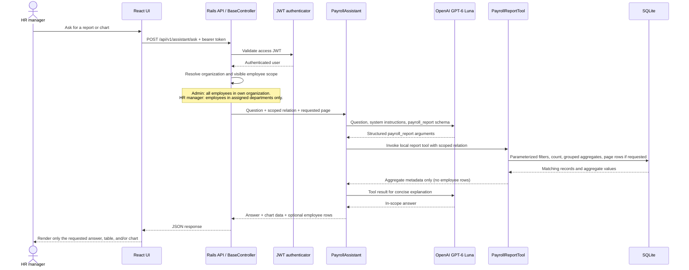
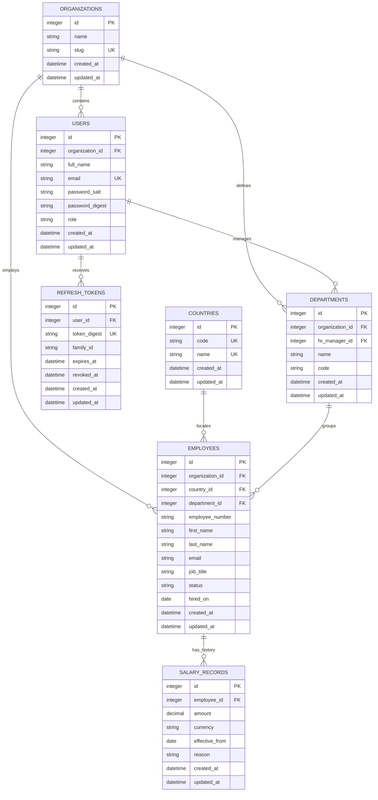

# Architecture, Data Flow, and Data Model

This document describes the current implementation of ACME Salary Management: a React UI, a Rails JSON API, a relational database, and an optional OpenAI model for payroll reporting.

## System architecture

```mermaid
flowchart LR
  HR[HR manager / admin] --> Browser[Browser]
  Browser --> React[React + TypeScript UI]
  React -->|JSON over HTTPS; bearer access token| Rails[Rails 8.1 API]
  React -. local development .-> Vite[Vite dev server]
  Vite -->|proxy /api| Rails

  Rails --> Auth[JWT authentication and tenant scoping]
  Auth --> Services[Controllers and domain services]
  Services --> Models[Active Record models and validations]
  Models --> DB[(SQLite database)]

  Services -->|question + tool schema; no DB connection| RubyLLM[RubyLLM payroll reporting agent]
  RubyLLM -->|OpenAI Responses API| OpenAI[OpenAI GPT-6 Luna]
  OpenAI -->|structured payroll_report tool call| RubyLLM
  RubyLLM -->|executes tool locally| ReportTool[PayrollReportTool]
  ReportTool -->|scoped SQL queries and aggregates| DB
  ReportTool -->|aggregate result for summary| RubyLLM
  Services -->|answer, chart data, requested page of rows| Rails
  Rails --> React
  React -->|table, chart, or answer| Browser
```

The browser never connects directly to the database . Rails owns authentication, tenant checks, validation, report queries, and salary calculations. The React client renders the API response. In development, Vite proxies API requests; in the container deployment, Rails serves the built frontend and API from one origin.

## Request and report data flow

### Tenant and data boundaries

- Authentication resolves the user from the signed bearer JWT. The organization is derived from that user; clients cannot select a tenant by passing an organization ID.
- Every employee and department query starts from the authenticated user's organization. Admin users see all organization employees and departments. HR managers are further restricted to departments assigned to their account.
- The assistant receives the same already-scoped employee relation used by the API. Its tool performs fixed, parameterized report queries; it cannot issue arbitrary SQL or choose another tenant.
- OpenAI receives the user's question, agent instructions, and tool schema. The report tool runs inside Rails. Only aggregate report metadata is sent back to the model; individual employee rows are included in the API response only when the request asks for a list or specific records.
- LLM credentials are read from server environment variables (`OPENAI_API_KEY` and optional `OPENAI_MODEL`). They are not part of the React bundle or database.
- Refresh tokens are held in an HTTP-only cookie, stored in the database as digests, and rotated on refresh. The browser uses the short-lived access JWT for protected API requests.

## Relational model

`COUNTRIES` is a shared reference table. All other business records are organization-owned directly or through their parent. Composite unique indexes enforce department name and code, employee number and email within an organization, and salary effective date within an employee. Organization slug, user email, country code and name, and refresh-token digest are globally unique. A department has one assigned HR manager, while a user may manage many departments. Salary changes are effective-dated records; the current salary is the latest record effective on or before the requested as-of date. Salary amounts retain their currency and are never aggregated across currencies.

## Main responsibilities

| Layer | Responsibilities |
| --- | --- |
| React + TypeScript | Sign-in, navigation, forms, accessible list/report presentation, chart and table rendering |
| Rails controllers | HTTP validation, authentication hooks, status codes, and JSON serialization |
| Rails services | Employee CRUD workflows, department management, dashboard summaries, session rotation, and report orchestration |
| Active Record models | Associations, field validation, tenant consistency validation, and database-backed relations |
| SQLite | Durable relational data, unique constraints, foreign keys, and indexed queries |
| RubyLLM + OpenAI | Parse a natural-language report request into a constrained tool call and summarize aggregate results |
