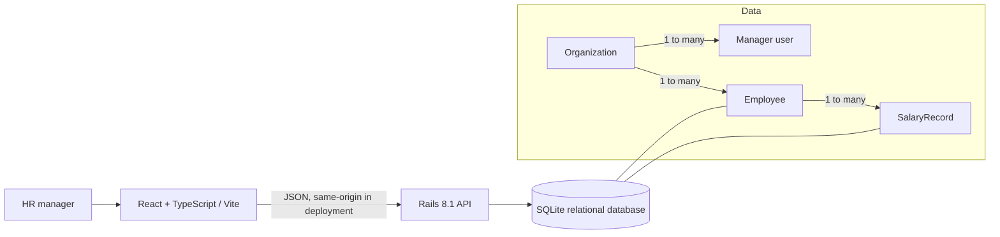

# Engineering Notes

## Architecture

The app is split into a frontend and API to keep UI iteration independent from the data and validation contract. Rails owns validation, effective-date semantics, query filtering, and aggregates. The frontend formats and displays values but never calculates payroll totals. In development, Vite proxies API traffic; a single container can serve the compiled frontend and API from one origin.

## Data choices

- `Organization` owns its manager users and employees. `User` is a manager account with a password digest; a signed, expiring bearer token identifies the manager and therefore the tenant for every protected API request.
- `Employee` stores organization/person directory attributes and a stable employee number unique within its organization.
- `SalaryRecord` stores an amount, ISO-style currency, effective date, and reason. Each change appends a new record; a unique employee/effective-date constraint avoids ambiguous same-day salaries.
- The current salary is the latest effective record whose date is on or before the current UTC date. Future-dated changes are visible in history but do not replace current pay early.
- Salary is stored as fixed-precision decimal. `Intl.NumberFormat` formats amounts in their local currency/locale. Currency groups remain separate for country and department reports; no foreign-exchange source or reporting date was specified.
- The seed creates stable `ACME-00001`–`ACME-10000` synthetic people and uses `example.test` emails. It inserts missing employee and salary natural keys, preserving local edits on reruns.

## Scale and query behavior

10,000 rows are deliberately seeded to make list and summary behavior tangible. Directory API calls filter and sort in SQL and return at most 100 rows per request. Employee and salary foreign-key, lookup, and effective-date indexes support common access paths. The page fetch uses one employee query and one current-salary query for the page. Dashboard averages and totals use grouped SQL aggregates, rather than loading all employee rows into application memory. SQLite is adequate for the deterministic assessment/demo dataset; a high-concurrency, multi-instance deployment should move to PostgreSQL and add load measurements before release.

## Trade-offs and boundaries

- **SQLite for a self-contained exercise:** easy to run and seed with no separate service. It serializes writes and is unsuitable for horizontal replicas or sustained payroll operations; PostgreSQL is the planned production move.
- **Manager-only access:** registration creates an organization and its first manager. Protected employee, salary, and dashboard APIs scope every query and mutation to the authenticated manager’s organization. The SPA stores the signed token in local storage for the demo; production should use a reviewed session strategy, rate limiting, password recovery, access audit, and stronger operational controls before real data.
- **No FX conversions:** combining amounts across currencies would produce misleading results without a trusted rate source and effective-date policy.
- **Append-only changes:** users can make a correction by appending a later record; this simple model preserves traceable history. Formal approval, retroactive adjustments, and audit immutability are follow-on product decisions.
- **Supported country and currency set:** the demo supports eight coherent country/currency pairs. Production must manage a validated country/currency reference and define localized tax/payroll policy separately.

## AI-assisted development notes

AI tools were used to scaffold Rails/React, draft the first schema and API outline, implement seed/UI/test code, and review edge cases while the implementation was built in milestones. The author checked the generated routes, database queries, seeded UI, current-vs-future salary behavior, validation rules, and test output; compiler/test findings were corrected before commits. AI output was treated as a draft: generated defaults that were unused (for example, asset/deployment gems) were removed to keep the dependency surface smaller, and the initial seed distribution bug was found by viewing the running interface and corrected.

## Suggested live demo

Follow [the demo walkthrough](../README.md#demo-walkthrough). A reviewer should see the list search/filter, a profile with history, a validated salary change, and compensation summaries with currencies kept separate. Use only synthetic records in any recorded or publicly hosted demo.
